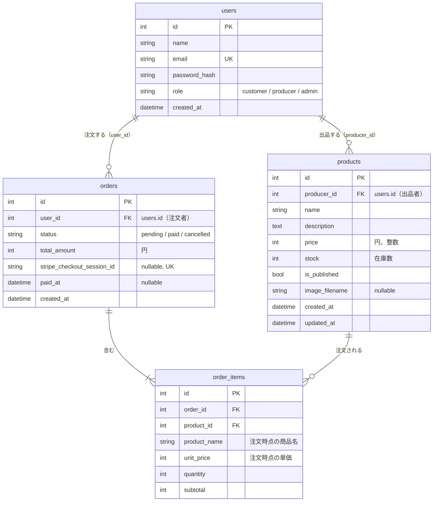

# データベース設計

[ユーザーストーリー（user_stories.md）](user_stories.md)と[画面一覧（screens.md）](screens.md)をもとにする。テーブル名とカラム名は[仕様書 3](../spec/03_database.md)に合わせる。`users` はスターターキットで作成済み（`marche/models.py`）。

<br>

## ER 図



<br>

## カラム定義

### users（作成済み）

| カラム | 型 | 制約 | 説明 |
|-|-|-|-|
| id | Integer | PK | |
| name | String(50) | not null | 表示名。生産者は農園名・屋号 |
| email | String(255) | not null, unique | 小文字にそろえて保存する |
| password_hash | String(255) | not null | `generate_password_hash` の結果。平文は保存しない |
| role | String(20) | not null, default `customer` | `customer` / `producer` / `admin`（Python 側は `Role` の StrEnum） |
| created_at | DateTime | not null, default 現在時刻（日本時間） | 登録日時 |

### products

| カラム | 型 | 制約 | 説明 |
|-|-|-|-|
| id | Integer | PK | |
| producer_id | Integer | not null, FK users.id（restrict）, index | 出品した生産者 |
| name | String(50) | not null | 「ほうれん草 1束」のように量も入れる |
| description | Text | not null, default `""` | 紹介文（2,000 字まで。長さはフォームで確かめる） |
| price | Integer | not null, CHECK 50〜100,000 | 税込みの円 |
| stock | Integer | not null, default 0, CHECK 0 以上 | いまある数。支払いが確定したときに減らす |
| is_published | Boolean | not null, default false | 公開中か。新しく登録した商品は非公開 |
| image_filename | String(100) | nullable | `static/uploads/` の中のファイル名（UUID ＋ 拡張子）。写真なしは NULL |
| created_at | DateTime | not null | 登録日時 |
| updated_at | DateTime | not null | 更新のたびに変わる（`onupdate`） |

### orders

| カラム | 型 | 制約 | 説明 |
|-|-|-|-|
| id | Integer | PK | 注文番号として画面に出す |
| user_id | Integer | not null, FK users.id（restrict）, index | 注文した人 |
| status | String(20) | not null, default `pending`, CHECK 3つの値のどれか | `pending`（支払い待ち）/ `paid`（支払い済み）/ `cancelled`（取り消し）。Python 側は `OrderStatus` の StrEnum |
| total_amount | Integer | not null | 合計（円）。明細の小計を足したもの。サーバーで計算する |
| stripe_checkout_session_id | String(255) | nullable, unique | Checkout Session の ID。注文を作った直後はまだ無いので NULL を許す |
| paid_at | DateTime | nullable | 支払いが確定した日時 |
| created_at | DateTime | not null, index | 注文日時。新しい順の並べ替えと、在庫の押さえ（35 分）の起点 |

### order_items

| カラム | 型 | 制約 | 説明 |
|-|-|-|-|
| id | Integer | PK | |
| order_id | Integer | not null, FK orders.id（cascade）, index | どの注文の明細か |
| product_id | Integer | not null, FK products.id（restrict）, index | どの商品か。売上の集計に使う |
| product_name | String(50) | not null | 注文時点の商品名 |
| unit_price | Integer | not null | 注文時点の単価 |
| quantity | Integer | not null, CHECK 1〜10 | 数量 |
| subtotal | Integer | not null | `unit_price × quantity` |

<br>

## 外部キーの削除時の動き

| 関係 | 削除時 | 理由 |
|-|-|-|
| orders → order_items | **cascade** | 明細は注文の一部なので、注文と一緒に消す。モデルでも `cascade="all, delete-orphan"` にする |
| products → order_items | **restrict** | 注文された商品が消えると、売上の集計と注文の記録が壊れる。注文がある商品は削除させず、非公開にしてもらう |
| users → products | **restrict** | コアではユーザーを削除しない。消せてしまうと、商品が出品者のいない状態になる |
| users → orders | **restrict** | 同じ理由。注文の記録を守る |

> SQLite は、設定しないと外部キーの制約（restrict）を確かめません。「注文がある商品は削除できない」は、ビューの中でも確かめて、分かりやすいメッセージを出します。そうすると、開発・テスト（SQLite）と本番（MySQL）で同じ動きになります。

<br>

## 在庫の方式

**支払いが確定したときに減らす方式**にする。

- `products.stock` は「いまある数」。生産者が収穫したら、いまの数に書き換えるだけでよい
- 注文を作っただけでは `stock` を減らさない。支払いが確定したとき（Webhook か支払い完了ページ）に、明細の数量だけ減らす
- 確定の処理が二重に走ると二重に減るので、「`status` が `pending` のときだけ `paid` に更新する」条件付き更新にし、更新できたときだけ減らす
- 取り消し（`cancelled`）のときは、もともと減らしていないので `stock` は戻さない

### この方式にした理由

| 方式 | 中身 | 利点 | 欠点 |
|-|-|-|-|
| A. 毎回計算 | `stock` は「入荷した総数」。売れた数を毎回引く | 減らす処理が要らない | 生産者が「これまでに入荷した総数」を入れないといけない |
| B. 支払い確定で減らす（採用） | `stock` は「いまある数」 | 生産者の感覚と同じ。毎日の収穫に合わせて書き換えるだけ | 二重に減る心配がある → 条件付き更新で防ぐ |

<br>

## いま買える数の計算

```text
いま買える数 = products.stock − （支払い待ちで、作成から35分以内の注文の、その商品の数量の合計）
```

- 一覧・詳細の在庫の表示、数量のセレクト（1〜min(10, いま買える数)）、注文を作るときの在庫の確認は、全てこの数を使う。0 以下なら「売り切れ」
- **支払い待ちも引く理由**：A さんが Stripe の画面でカード番号を入れている間に、B さんが最後の1個を買えてしまうのを防ぐ
- **35分の理由**：Stripe の Checkout Session の有効期限は最短30分。期限が切れた決済ページでは支払えないので、少し余裕を見た35分を過ぎた支払い待ちは数えない（決済ページを閉じたまま放置した人が、いつまでも在庫を押さえないように）
- 計算は `marche/services/inventory.py` の `available_stock(product)` に置き、views からはこの関数を呼ぶ
- SQLAlchemy の `select()` と `func.sum()` で書く。35分前の時刻は Python で計算して渡す（SQLite 専用の日付関数は使わない）

### 残る問題（コアでは対策しない）

- 2人が同時に最後の1個を注文すると、両方の注文が通ることがある。支払い確定のときに `stock` が足りなければ 0 で止める。対策（行ロック、在庫不足なら返金）は拡張 E1

<br>

## 決めたことの補足

- **CHECK 制約**：価格・在庫・数量・状態の範囲は、フォームで確かめたうえで、DB にも CHECK を付けて守る。SQLite でも MySQL 8.0 でも動く書き方にする
- **本番は MySQL**：文字列のカラムには全て長さを付ける
- **仕様書 3 から外したもの**：`stripe_payment_intent_id` は返金（拡張 E2）でしか使わないので、コアには入れない
- **生産者ごとの売上**：1回の注文に複数の生産者の商品が入ることがあるため、`order_items` と `products` を結合し、`producer_id` と `status = paid` で絞って集計する
